# RYMEC GRIEVANCE DESK

### A Smarter, Transparent, and Accountable Student Grievance Management Platform
**Institution:** Rao Bahadur Y. Mahabaleswarappa Engineering College (RYMEC), Ballari, Karnataka  
**Managed by:** Veerasaiva Vidyavardhaka (V.V.) Sangha, Ballari (Estd. 1980)  
**Accreditation:** NAAC A+ Grade • NBA Accredited Programs • Affiliated to VTU Belagavi • AICTE Approved  

---

## 🏛️ 1. Project Overview & Problem Statement

In academic and residential institutions, student grievances submitted through informal or unstructured channels (verbal complaints, loose paper registers, unmonitored WhatsApp groups) frequently suffer from lack of tracking, missing accountability, delayed triage, and student hesitation to report sensitive matters due to fear of identity exposure.

**RYMEC GRIEVANCE DESK** is a full-stack, enterprise-grade institutional grievance management system designed with modern **Liquid Glass + Pebble UI** aesthetics. It empowers students with guaranteed SLA turnaround tracking, cryptographic anonymous reporting, and real-time package-style milestone tracking, while equipping faculty, wardens, department heads, and the Principal with automated triage, duplicate detection, systemic trend alerts, and an immutable audit trail.

---

## 🏗️ 2. System Architecture

```mermaid
graph TD
    A[Student / Public Client] -->|React + Vite + Framer Motion| B(Liquid Glass UI & Bottom Nav)
    B -->|REST API Requests| C[Express.js API Server]
    
    subgraph Intelligent Triage Engine
        C --> D[AI Auto-Categorization]
        C --> E[Priority & Urgency Detection]
        C --> F[Duplicate Detection Jaccard]
        C --> G[Predictive Resolution Estimator]
        C --> H[Systemic Trend Detector 5+ Pattern]
    end

    subgraph Database & Persistence
        C -->|pg Pool & Migrations| I[(PostgreSQL Database - Neon Cloud)]
        C -->|Resilient Fallback| J[(In-Memory Resilient Store)]
    end

    subgraph Notifications & Security
        C --> K[Nodemailer SMTP Dispatcher]
        C --> L[JWT Token & bcrypt Hashing]
        C --> M[QR Code Generator]
        C --> N[Multer Document Storage]
    end

    subgraph Six Institutional Dashboards
        C --> O[1. Student Portal]
        C --> P[2. Lecturer Desk - Academic]
        C --> Q[3. Warden Office - Hostel & Mess]
        C --> R[4. HOD Portal - Department & Escalation]
        C --> S[5. Mentor Desk - Welfare & Counseling]
        C --> T[6. Principal Executive - Full Oversight & Audit]
    end
```



---

## 💎 3. Design Philosophy — Liquid Glass + Pebble Effect

The application is crafted using an iOS-inspired **Liquid Glass + Pebble Effect** design language:

### Liquid Glass Surface
* **Backdrop Blur:** Multi-layered `backdrop-filter: blur(18px) saturate(160%)` creating physical glass refraction.
* **Specular Light Reflections:** Dynamic mouse-following radial light glints (`--mx`, `--my`) responding to cursor movement.
* **3D Perspective Tilt:** Interactive tilt physics returning gracefully via Framer Motion spring physics.
* **Translucent Layering:** Deep Navy (`#0B132B`, `#1C2541`), Midnight Blue (`#10172A`), Soft Cyan (`#38BDF8`), and Subtle Violet accents (`#818CF8`).

### Pebble Effect
* **Organic Pill Geometry:** Full pill rounding (`rounded-full`, `rounded-3xl`) with soft ambient shadows (`0 16px 36px -10px rgba(0,0,0,0.45)`).
* **Tactile Spring Physics:** Micro-interactions on hover (`scale: 1.03`) and active click press (`scale: 0.97, y: 1`).
* **Floating Liquid Glass Bottom Navigation Bar:** Floating glass pill at viewport bottom with fluid tab switching, animated indicator (`layoutId="liquid-pill"`), and mobile safe-area padding.

---

## 👥 4. Six User Roles & Access Control Matrix

| Role | Target Jurisdiction | Permitted Operations |
|---|---|---|
| **1. STUDENT** | Personal Grievances | Register, login, file public or anonymous complaints, attach evidence (PDF/PNG/JPG), generate QR code, track package timeline, reopen resolved complaint (max 2x), rate satisfaction (1-5 stars). |
| **2. LECTURER** | Academic & Labs | Review academic grievances, update status, add official remarks/action-taken report, monitor SLA deadlines. |
| **3. WARDEN** | Hostel, Mess & Facilities | Manage residential complaints (RO water, geysers, Wi-Fi, food quality), inspect recurring maintenance patterns, issue remarks. |
| **4. HOD** | Department & Escalations | Review department queues, handle Level-1 escalated complaints, reassign faculty, review departmental analytics. |
| **5. MENTOR** | Student Welfare & Counseling | Handle personal, library, sports, and counseling grievances with confidential remarks. |
| **6. PRINCIPAL** | Full Institutional Oversight | Complete access across all departments, institutional analytics telemetry, Level-2 executive escalation review, staff jurisdiction configuration, immutable audit logs. |

---

## ⚡ 5. Intelligent Features Breakdown

1. **AI Auto-Categorization & Department Auto-Routing:**  
   Natural language processor evaluates vocabulary against weighted domain keyword dictionaries (`hostel`, `academic`, `harassment`, `admin`, `other`) and routes directly to the responsible office.
2. **Priority & Urgency Detection:**  
   Instant detection of emergency, safety, and harassment triggers (`ragging`, `harassment`, `safety hazard`, `electric shock`) flags **URGENT** priority (24-hour turnaround) or **HIGH** priority (72-hour turnaround).
3. **Guaranteed SLA Countdown Engine:**  
   Calculates precise remaining time. When an issue exceeds deadline without closure, an automated background cycle marks it as **OVERDUE** and auto-escalates to the HOD and Principal.
4. **Anonymous Safety Shield:**  
   When "Submit Anonymously" is selected, the student's name, USN, and contact info are shielded as "Anonymous Student" in ordinary staff interfaces. A cryptographic internal link is maintained strictly for authorized emergency oversight.
5. **Duplicate Complaint Detection:**  
   Calculates tokenized Jaccard similarity across complaints filed within the last 14 days in the same category. Warns the student if an identical issue is already under investigation.
6. **Systemic Trend / Pattern Detection (5+ Pattern Alert):**  
   Automatically aggregates complaints over the trailing 7-day window. If 3 to 5+ complaints surface on a common keyword (e.g., "drinking water purifier", "mess food rice"), an active systemic alert banner appears on staff dashboards recommending root-cause inspection.
7. **1-Click Mobile QR Code Tracking:**  
   Generates a scannable QR code on grievance confirmation, linking directly to the live mobile tracking view.
8. **Interactive FAQ & Status Chatbot:**  
   Conversational bot where students can type their complaint ID to pull live milestone status, or ask about college policies, hostel timings, and anti-ragging protections.
9. **Post-Resolution Satisfaction Rating:**  
   Resolved grievances invite students to rate the solution (1 to 5 stars) and submit qualitative feedback, directly populating institutional quality metrics.
10. **Complaint Reopening with Justification:**  
    Students dissatisfied with a closure can reopen it (capped at 2 times) with written justification, immediately elevating priority for senior re-examination.
11. **Anonymized Public Transparency Wall:**  
    A public feed of resolved grievances (e.g., "Hostel Wi-Fi issue - Resolved in 2 days"), showcasing college accountability and building trust.

---

## 💾 6. Database Schema (PostgreSQL)

The database runs on **PostgreSQL (Neon Cloud)** with 8 relational tables:
* `departments`: id, name, code, category_mapping, contact_email, description.
* `users`: id, full_name, email, password_hash, role, usn_roll, department, academic_year, hostel_block, designation, is_verified.
* `complaints`: id, complaint_number (`GRV-2026-XXXXX`), student_id, is_anonymous, student_name_snapshot, title, description, category, department_id, priority, status, assigned_to, sla_deadline, is_escalated, escalation_level, reopening_count, resolved_at.
* `complaint_attachments`: id, complaint_id, file_name, file_url, file_size, mime_type.
* `complaint_timeline`: id, complaint_id, action_by, action_role, status, remark, is_internal, created_at.
* `complaint_ratings`: id, complaint_id, student_id, rating (1-5), feedback.
* `notifications`: id, user_id, title, message, link, is_read.
* `audit_logs`: id, user_id, action, entity_type, entity_id, details (JSONB), created_at.

---

## 🔑 7. Demo Accounts (Password: `password123` for all)

For easy examination and viva evaluation, 1-click test login buttons are integrated into the login modal:

| Role | Demo Email | Name & Designation | Primary Function |
|---|---|---|---|
| **Student** | `student.rahul@rymec.edu.in` | Rahul Sharma (3BR21CS045) | Submit, track, reopen, rate |
| **Lecturer** | `lecturer.anita@rymec.edu.in` | Prof. Anita Deshmukh (Asst. Prof, CSE) | Academic complaint resolution |
| **Warden** | `warden.mallikarjun@rymec.edu.in` | Dr. Mallikarjun G. (Chief Warden) | Hostel, food & facility redressal |
| **HOD** | `hod.cse@rymec.edu.in` | Dr. Veerendra Kumar (HOD, CSE) | Department escalations & staff assignment |
| **Mentor** | `mentor.priya@rymec.edu.in` | Dr. Priya Kulkarni (Student Counselor) | Student welfare & personal grievances |
| **Principal** | `principal@rymec.edu.in` | Dr. T. Hanumantha Reddy (Principal) | Executive oversight, analytics & audit logs |

---

## 🚀 8. Running the Application

### Option A: 1-Click Launch (Windows)
Double-click `start.bat` in the project root directory. It will start both backend (port 5000) and frontend (port 5173) in separate windows.

### Option B: Manual Command Line
#### 1. Backend
```bash
cd backend
npm install
npm start
```
Backend runs on `http://localhost:5000`.

#### 2. Frontend
```bash
cd frontend
npm install
npm run dev
```
Frontend runs on `http://localhost:5173`.

---

## 🧪 9. Complete End-to-End Testing Walkthrough

1. **Visit Landing Page (`http://localhost:5173`):**  
   Observe the verified RYMEC campus visual hero, NAAC A+ banner, liquid glass cards, and feature highlights.
2. **1-Click Student Login:**  
   Click "Sign In", click "Student" in the 1-Click Demo Login bar.
3. **Submit a Grievance:**  
   Click "Submit" in the floating bottom navigation bar. Type title: *"Water cooler contamination in Aryabhata hostel"* with anonymous mode checked. Notice auto-triage detecting Category `Hostel` and calculating SLA.
4. **Confirm Submission:**  
   Click "Submit". Watch confetti celebration, unique ID generation (`GRV-2026-XXXXX`), QR code preview, and AI resolution estimate.
5. **Track Complaint:**  
   Click "Track Complaint Timeline". Inspect milestone checkpoints and remaining SLA countdown.
6. **Warden / Staff Inspection:**  
   Sign out, 1-click login as **Warden**. See the hostel queue, notice the systemic trend alert banner, click the complaint, change status to `Resolved`, add an action-taken remark, and click Save.
7. **Satisfaction Rating:**  
   Switch back to Student, open the complaint, rate it 5 stars, and leave feedback.
8. **Principal Analytics & Audit Log:**  
   Login as **Principal**, navigate to "Analytics" to view Recharts category distributions, monthly resolution flow, department performance, and inspect the immutable audit logs under "Profile" / "Audit Logs".

---

© 2026 Rao Bahadur Y. Mahabaleswarappa Engineering College (RYMEC), Ballari. Managed by V.V. Sangha.
